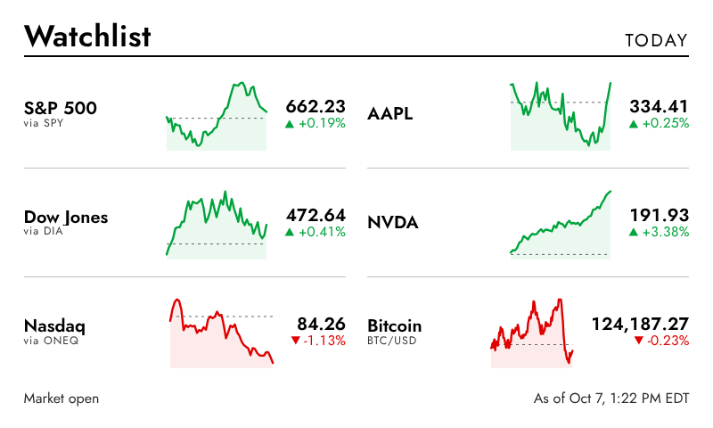
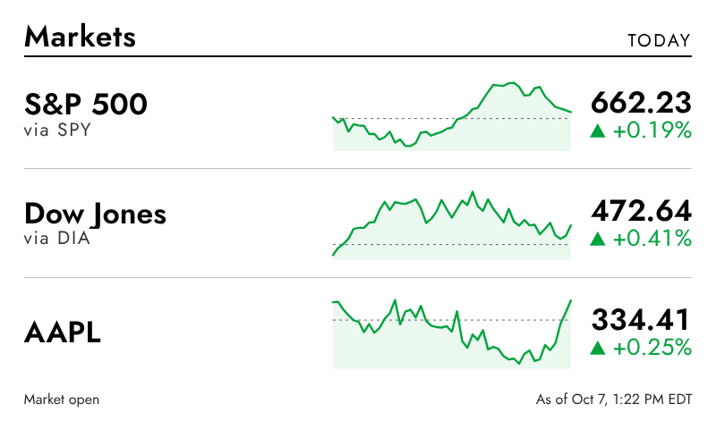
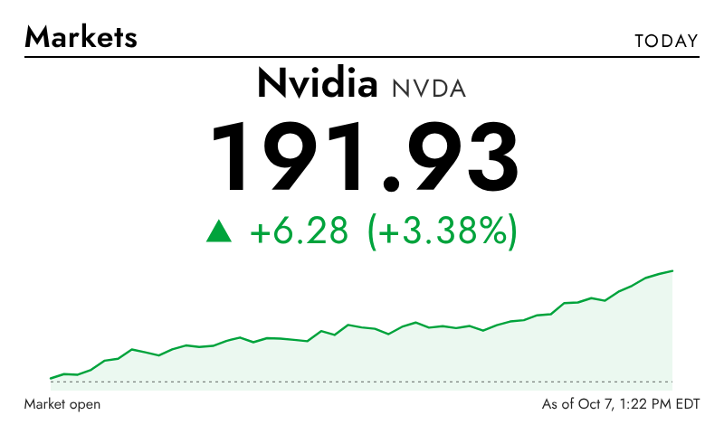

# InkyPi Stocks Plugin

A stock market plugin for [InkyPi](https://github.com/fatihak/InkyPi). It shows prices for indexes, stocks, ETFs and crypto on an e-ink display, with the change over a time range you choose and an optional chart for each ticker.



| Rows (2–5 tickers) | Single ticker |
|---|---|
|  |  |

*The previews were rendered from sample data.*

## Features

- Up to 8 tickers: indexes (`^GSPC`, `^DJI`, `^IXIC`, `^RUT`), stocks (`AAPL`), crypto (`BTC-USD`), gold (`GC=F`) and forex (`EURUSD=X`)
- Layout adjusts to the number of tickers: one large display for 1 ticker, rows for 2–5, two columns for 6–8 on landscape screens
- Change measured over Today, 5 days, 1, 3 or 6 months, YTD, 1 year or 5 years
- Chart for each ticker, with a dashed line marking the starting price
- Green and red for gains and losses, or black and white with arrows only
- Custom labels: `MSFT=Microsoft`
- Supports InkyPi's frame, background and text color options
- Footer shows whether the market is open and the time of the data, in your device's timezone

## Data source

Market data comes from [Twelve Data](https://twelvedata.com). Their free Basic plan allows 8 symbols per minute and 800 requests per day. That's enough to refresh 8 tickers about every 15 minutes during market hours.

To limit API usage, the plugin:
- Fetches all tickers in a single batched request
- Reuses data fetched in the last 4 minutes, and up to an hour when markets are closed
- Shows the last good data if a request fails
- Uses each index's ETF (SPY, DIA, ONEQ, IWM) if your plan doesn't include the index, labeled "via SPY" and so on. It remembers this so it doesn't request unavailable symbols again

## Installation

1. Install the plugin on your Pi:
   ```bash
   inkypi plugin install stocks https://github.com/raj-gitsome/inkypi-stocks
   sudo systemctl restart inkypi.service
   ```
   Or copy the `stocks/` folder into `InkyPi/src/plugins/` and restart the service.

2. Get a free API key at [twelvedata.com/pricing](https://twelvedata.com/pricing).

3. In the InkyPi web UI, open **API Keys** and add the key as `TWELVE_DATA_API_KEY`.

4. Open **Stocks** from the plugin list, enter your tickers, and click **Update Now** or add it to a playlist. A refresh interval of 15 minutes or longer stays within the free plan.

No extra Python packages are needed.

## Troubleshooting

Problems appear as messages in the web UI. More detail is in the service log:

```bash
journalctl -u inkypi -n 50
```

| Message | Fix |
|---|---|
| Add a free Twelve Data API key… | Save `TWELVE_DATA_API_KEY` on the API Keys page |
| Twelve Data rejected the API key | Check the key for typos |
| Rate limit reached | Use fewer tickers or a longer refresh interval |
| Unknown symbol | Check the ticker spelling |

## License

GPL-3.0, the same license as InkyPi.
